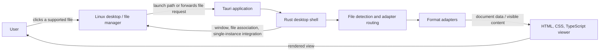

# ShoruiPoppu Architecture

**Status:** Initial architecture, based on the project brief  
**Date:** 28 October 2026

## Purpose

ShoruiPoppu is a read-only desktop viewer for opening local documents from a file manager. The app opens the original file, parses only what it needs to display, and renders the content in a focused popup window. It does not save edits or create converted document files.

This document records the intended system boundaries and runtime flow. It does not select libraries beyond those named in the project brief.

## Goals and boundaries

- Open supported files from the operating system and display them in individual viewer windows.
- Show the window promptly, then parse and render content as needed.
- Keep format-specific parsing behind a consistent adapter boundary.
- Keep document content on the user's device. No upload or cloud service is part of the MVP.
- Avoid writing converted PDF, HTML, or other document copies to disk.
- Keep the interface read-only and focused on the content.

Editing, saving, collaboration, cloud sync, and full Microsoft Office compatibility are outside the MVP.

## System context

The initial target is Linux, especially CachyOS with Hyprland. Windows support may follow after file opening and rendering for the primary formats are stable.

## Main components

### Desktop shell

The Tauri 2 application owns process startup, viewer-window creation, launch-argument handling, and operating-system integration. It receives a file path when launched from a file manager. If another app process is already running, single-instance handling forwards the new request to that process, which opens another viewer window.

The shell should create and show the window before document parsing has completed. It also coordinates local file access and reports failures to the viewer in a form the user can understand.

### Viewer UI

The frontend is plain HTML, CSS, and TypeScript without a large UI framework. It displays the content supplied by the selected format adapter and provides the shared viewer controls:

- Scroll through content and change zoom where applicable.
- Search within a document where supported.
- Navigate slides and open another file.
- Close the current viewer window.

The UI should prioritize the current page, sheet, slide, or text content. Format-specific rendering can use different layouts while sharing the same window and interaction principles.

### Format detection and adapters

The application identifies a file's format and routes it to an adapter owned by the window's document session. Opening and navigation run in blocking workers, with independent sessions serialized per window. Static content remains in the session; XLSX readers and presentation packages retain their open file handles, and selected worksheets use a sparse in-memory cell model. Closing a window removes its session, and any in-flight operation releases its reference when it finishes. PDF rendering resources live in the frontend.

The intended adapter lifecycle is:

1. Detect or confirm that it can handle the file.
2. Open and parse the source file locally.
3. Provide the content needed for the current view and subsequent navigation.
4. Release document resources when the viewer closes or changes files.

The adapter boundary keeps file-format details out of the shared shell. Tagged Rust-to-TypeScript messages cover empty, PDF bytes, Markdown tokens, plain text, grids, workbook metadata, DOCX blocks, PPTX slide data, unsupported files, and errors. Each response declares its supported controls. Workbook viewport requests return only the requested cells and validate their dimensions and active sheet. Document text is inserted with DOM text APIs rather than interpreted as HTML.

| Format | Adapter responsibility | Display strategy |
| --- | --- | --- |
| PDF | Read pages through PDF.js. | Render the visible page first; load other pages as needed. |
| DOCX | Read the OOXML package and expose document content. | Render directly in the WebView; fidelity limits include complex layout and specialized elements. |
| XLS/XLSX | Read workbook and worksheet data with Calamine. | Display worksheets in a scrollable grid that virtualizes rows. |
| PPTX | Read the OOXML presentation and expose slide content. | Render slides directly in the WebView; the MVP is static, with basic slide navigation. |
| Markdown | Parse Markdown with a Rust parser. | Render headings, paragraphs, lists, links, code blocks, and tables in the viewer without writing an HTML file. |
| CSV and plain text | Read local text or delimited rows. | Display as text or a simple grid. |

Legacy PPT and DOC use different formats and need separate readers. ODT and ODS are later-format candidates rather than MVP acceptance requirements.

## Opening a document

1. The operating system starts ShoruiPoppu with a file path, or forwards a new file request to the running instance.
2. The shell creates and shows a viewer window promptly, with an initial loading state if needed.
3. The application detects the format and opens the matching adapter.
4. The adapter parses the source locally and supplies the first visible content.
5. The viewer renders the current page, sheet, slide, or text. Additional content is loaded when navigation requires it.
6. The user can navigate, search, zoom, open another file, or close the window.
7. Closing the document releases its in-memory state and temporary resources.

Parsing and rendering should continue without blocking the initial window display. Large PDFs and workbooks must not require rendering all pages or rows before showing the first useful content.

## Data handling and safety

- Source files are read locally and are not sent over the network.
- The app does not create converted document files as an intermediate step.
- Any document cache is temporary and in memory for the open document.
- Markdown input is untrusted: raw embedded HTML and external resources must be disabled, restricted, or explicitly controlled.
- Malformed, damaged, encrypted, or unsupported files should produce a clear error rather than crashing the viewer.
- The viewer is read-only; it does not modify the source file.

## Performance approach

- Show the viewer window before parsing finishes.
- Render the visible PDF page or PPTX slide first and defer other content until requested.
- Virtualize spreadsheet rows so large worksheets do not create a full DOM grid at once.
- Keep the process ready in the user session only if profiling shows that this is needed to improve popup latency.
- Measure time to window display and time to first visible content on the target machine before setting numerical targets. An opt-in local log records approximate first window and content frame times; see the README.

## Compatibility limits

The viewer presents parsed document content; it does not reproduce every behavior of the source application. DOCX layout can differ from Word, especially around fonts, pagination, text boxes, SmartArt, and specialized elements. PPTX support initially focuses on static slides; charts, SmartArt, embedded media, fonts, transitions, and animations may differ from PowerPoint or remain unsupported.

Compatibility claims should be based on representative real-world files for each format. Large and image-heavy documents, encrypted files, and damaged files need deliberate handling.

## Open decisions

- Validate the initial DOCX and PPTX OOXML subset against representative files.
- Verify the pulldown-cmark token representation and its rendering in the desktop WebView.
- Confirm Linux packaging, file/MIME associations, and single-instance behavior on the target desktop.

## Current implementation limitations

XLSX worksheet cells are progressively scanned into a bounded sparse in-memory model, and only viewport cells are transferred to the frontend. The first populated cells can appear before scanning completes; switching sheets or closing the session cancels the previous scan. A late parsing or size-limit error is reported alongside the cells already read. Calamine loads XLS workbooks eagerly, so a Linux helper limits its address space and CPU time; large XLS workbooks may be rejected. PDF navigation includes page selection, and grid row headers remain visible when scrolling horizontally. PPTX slides inherit basic layout/master artwork and solid backgrounds and can use the layout position of a matching placeholder; inherited text styles and complex layouts are not implemented. DOCX/PPTX parsing is a small OOXML subset, not a full layout engine. See the README for feature limits. Desktop integration, representative-file fidelity, first-content timing, and end-to-end privacy checks remain unverified on the target Linux machine.
